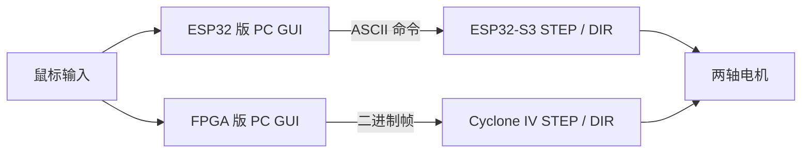

# 鼠标控制双轴云台 · 两条主控路线

Python Tkinter / ESP32-S3 / Verilog / Cyclone IV

[现场演示与项目介绍](https://dgwfpga.cn/showcase/mouse-gimbal.html) · [地瓜丸的 FPGA 教学平台](https://dgwfpga.cn/) · [验证范围](VALIDATION.md)


电脑鼠标输入分别接到 ESP32-S3 固件和 FPGA 逻辑，两版各有自己的上位机与协议。它们共用“两轴鼠标控制”的目标，但配置与串口数据不能互换。



| 目录 | 主控 / 工具 | 上位机入口 |
| --- | --- | --- |
| `esp32` | ESP32-S3，ESP-IDF；另留 Arduino 版本 | `esp32/pc/mouse_gui.py` |
| `fpga` | EP4CE6E22C8，Quartus 18.1 工程 | `fpga/pc/mouse_gimbal_control.py` |

## ESP32-S3 版

```powershell
pip install -r esp32/requirements.txt
python esp32/pc/mouse_gui.py
cd esp32/firmware_idf
idf.py set-target esp32s3
idf.py build
idf.py -p <你的串口> flash monitor
```

接线、命令与使用步骤见 [ESP32 版说明](esp32/README.md) 和 [新手入口](esp32/START_HERE_先看我.md)。当前 `USE_ENABLE_PINS=0`；GPIO6 同时作为激光输出及停用的 Y_EN 声明，若启用使能输出必须先重分配引脚，不能只切换开关。

## FPGA 版

```powershell
pip install pyserial
python fpga/pc/mouse_gimbal_control.py --port <你的串口>
cd fpga
.\build.ps1
.\program.ps1
```

脚本先尝试本机 Quartus 18.1 路径，再查找 PATH 中的工具。烧录是手动步骤，本仓库的发布检查没有执行烧录或连接电机。引脚仅适用于原工程对应的 Cyclone IV 板卡，见 [FPGA 版接线](fpga/README.md)。

FPGA 接收一次有效帧后保持输出设置，原 RTL 没有独立的串口断链超时；PC 的停止命令与硬件断链保护不是同一回事。联调时先确认停止路径和机械行程。没有将本快照包装成已完成长期运行验证的控制器。


## 许可与贡献

项目代码按 [MIT](LICENSE) 发布，依赖与原始署名见 [NOTICE.md](NOTICE.md)。欢迎附上所用硬件、固件／工具版本、复现步骤和日志提出问题；请先去除自己的网络密码和设备信息。
